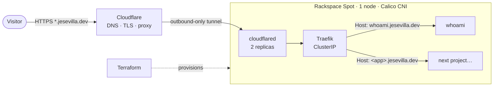

# infra · Kubernetes on a ~$4/month budget

Personal Kubernetes platform on [Rackspace Spot](https://spot.rackspace.com), exposed to the internet through a
Cloudflare Tunnel — **no public load balancer, no inbound ports, no public IP**.
It hosts my personal projects under `*.jesevilla.dev`.

**Live demo:** <https://whoami.jesevilla.dev>

## Highlights

- **~$4/month all-in.** Spot instances are billed at market price (~$0.005/h for a 4 vCPU / 32 GB node), the
  control plane is free, and the tunnel replaces a ~$10/month cloud load balancer.
- **Zero inbound exposure.** `cloudflared` opens an outbound-only connection to Cloudflare; the cluster has no
  `LoadBalancer` Service and no reachable IP.
- **One tunnel, one Gateway, one routes file.** A wildcard DNS record and tunnel route send every `*.jesevilla.dev` request to
  Traefik, which routes by `Host` header. Publishing a project needs no DNS or Cloudflare changes.
- **Infrastructure as code.** The cluster is provisioned with Terraform; Kubernetes manifests and Helm values
  live in this repo with pinned versions.
- **Documented like production.** [Architecture decisions](docs/decisions/), a real
  [incident postmortem](docs/incidents/2026-10-07-traefik-loadbalancer.md), a
  [change record](docs/changes/2026-10-14-ingress-to-gateway-api.md), an
  [operations runbook](docs/operations.md) and a [troubleshooting log](docs/troubleshooting.md).

## Architecture



1. Cloudflare terminates TLS for `*.jesevilla.dev` and forwards the request through the tunnel.
2. `cloudflared` is "blind": it sends every hostname to Traefik's internal Service.
3. Traefik matches the `Host` header against the HTTPRoutes in [`k8s/gateway/routes.yaml`](k8s/gateway/routes.yaml)
   (Gateway API, single Gateway) and routes to the right Service. No matching route → `404`.

## Stack

| Layer | Choice | Why |
|---|---|---|
| Compute | Rackspace Spot, 1 × `mh.vs1.large-dfw` (4 vCPU, 32 GB) | Auction pricing, free control plane — [ADR-0001](docs/decisions/0001-rackspace-spot.md) |
| Provisioning | Terraform + `rackerlabs/spot` provider | Reproducible cluster — [ADR-0006](docs/decisions/0006-local-terraform-state.md) |
| Network (CNI) | Calico | Default supported by Spot |
| Routing | Traefik (Helm chart 41.6.0) + Gateway API | One Gateway, centralized routes — [ADR-0003](docs/decisions/0003-traefik-ingress.md), [ADR-0007](docs/decisions/0007-gateway-api.md) |
| Edge | Cloudflare Tunnel + wildcard DNS | No load balancer, no open ports — [ADR-0002](docs/decisions/0002-cloudflare-tunnel.md) |
| Secrets | Created out-of-band, never in Git | [ADR-0005](docs/decisions/0005-secrets-out-of-git.md) |

## Costs

| Item | Cost |
|---|---|
| Compute (market price, 1 node) | ~$0.005/h ≈ **$3.60/month** |
| Bid ceiling (max I can be charged) | $0.02/h ≈ $14.40/month |
| Control plane, ingress traffic | $0 |
| Load balancer | $0 (avoided ~$10/month) |
| Domain | billed separately by the registrar |

Trade-off: a single Spot node can be preempted. That is acceptable for a portfolio, and the reasoning is in
[ADR-0004](docs/decisions/0004-single-node.md).

## Repository layout

```
.
├── terraform/spot-cluster/   # Cloudspace + node pool (Rackspace Spot)
├── k8s/
│   ├── traefik/values.yaml   # Helm values (ClusterIP, no LoadBalancer)
│   ├── cloudflared/          # Tunnel connector (2 replicas)
│   ├── gateway/              # The only Gateway + every HTTPRoute (routes.yaml)
│   ├── personal-web/         # Portfolio (jesevilla.dev): one file per resource + Kustomize
│   └── whoami/               # Demo app: Namespace, Deployment, Service, ReferenceGrant
├── scripts/
│   └── spot-kubeconfig.sh    # Refreshes the short-lived kubeconfig token
├── docs/
│   ├── decisions/            # Architecture Decision Records (ADRs)
│   ├── changes/              # Change records (what was applied, with commands)
│   ├── incidents/            # Postmortems
│   ├── operations.md         # Bootstrap and day-2 runbook
│   └── troubleshooting.md    # Problems found and how they were solved
└── .github/workflows/ci.yml  # fmt/validate, manifest schema checks, secret scanning
```

## Getting started

The full bootstrap (Terraform → kubeconfig → Traefik → tunnel → first app) is in
[docs/operations.md](docs/operations.md). The short version:

```bash
cd terraform/spot-cluster
cp terraform.tfvars.example terraform.tfvars        # adjust region, server class, bid
export TF_VAR_rackspace_spot_token=...              # never commit it
terraform init && terraform apply
../../scripts/spot-kubeconfig.sh
kubectl get nodes
```

## Roadmap

- [ ] GitOps with Argo CD, published behind Cloudflare Access
- [ ] Remote Terraform state on Cloudflare R2
- [ ] Preemption alerts through `preemption_webhook`
- [ ] Portfolio site on the root domain `jesevilla.dev`
- [ ] Ephemeral preview environments per pull request (separate project built on this platform)

## License

[MIT](LICENSE) © José Enrique Sevilla Larrea
